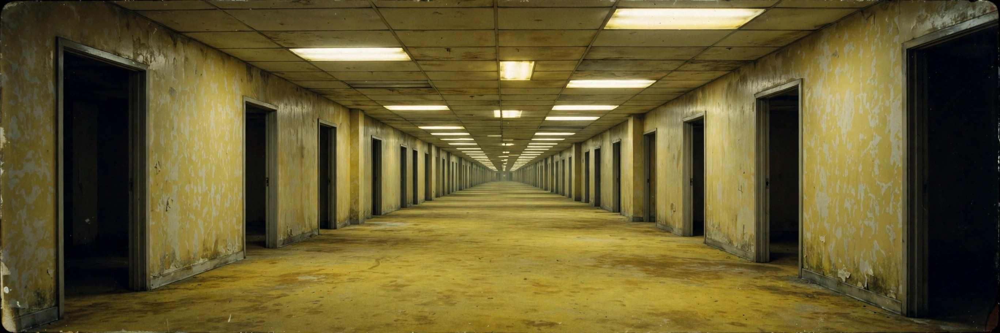

# ⚠️ YOU NOCLIPPED OUT OF REALITY

> *If you're not supposed to be here, don't worry. Nobody is.*
>
> *The hum of the fluorescent lights is normal. The empty rooms are normal.*
> *You are now in **Level 0** — the GitHub profile of **Advait**, aka **Addysaur**.*

---

## 🧑‍🚀 WHO WANDERED IN HERE?

**Hi, I'm Advait.** First-year B.Tech in AI & ML at Newton School of Technology.

I build things, break things, edit videos, and keep wandering into new rooms — sometimes literally, sometimes just in code.

- 🎓 B.Tech, AI & ML — Newton School of Technology
- 💻 Building with Python, JavaScript, and AI tools
- 🎬 Video editor — DaVinci Resolve, FrameDrop society
- 🎵 Makes beats in FL Studio, on the side
- 📍 Currently exploring: AI/ML, full-stack builds, and liminal spaces

---

## 🚪 ROOMS YOU CAN ENTER

### 🚪 Room 001 — KisanLabel
Pesticide label reader for Indian farmers. Built for Hacktoberfest HackDay on the Gemma track — FastAPI backend, Streamlit UI, and a local Gemma model via Ollama.
> ✅ Selected for the **XERJ Corpus Hub**

### 🚪 Room 002 — RescueRoute AI
AI-powered surplus food rescue — matching restaurants and college canteens to NGOs by pickup feasibility, before the safe deadline. Built for CoNSTruct 2.0, Track A.

### 🚪 Room 003 — The College Prompt Pack
40 AI prompts for Indian college students. My first digital product on Gumroad.

### 🚪 Room 004 — FrameDrop & Edits
Video edits, motion design, and the hype reel in progress.
Find my edits on Instagram: **[@whattfduo_](https://instagram.com/whattfduo_)**

---

## 🛠️ SUPPLIES FOUND IN THIS LEVEL

---

## 📊 SURVEILLANCE FOOTAGE

---

## ⚠️ SURVIVAL NOTES

- `don't panic` — the rooms go on forever, the ideas do too
- `keep building` — becoming happens sideways, while you're busy making
- `don't follow the hum` — unless it's a good beat
- `if you see an exit door, take it` — then come back and build something in the next room

---

## 🔗 EXITS

- 🐙 GitHub: [@addysaur](https://github.com/addysaur)
- 📸 Instagram: [@whattfduo_](https://instagram.com/whattfduo_)

---

  <i>~ you are not lost. you are just in Level 0. ~</i>

